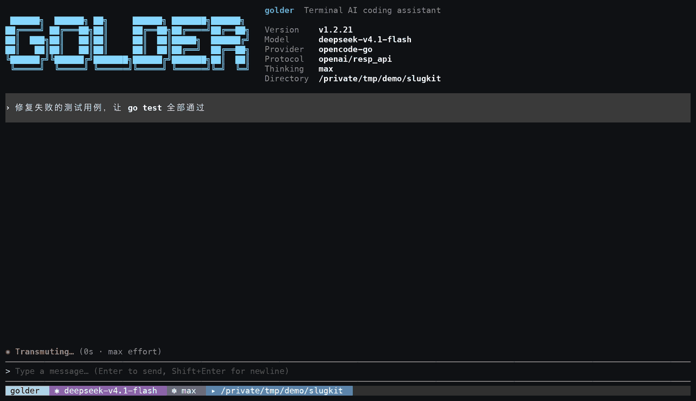

# golder

**English** | [简体中文](README.md)

[](https://github.com/getan/golder/actions/workflows/ci.yml)
[](https://github.com/getan/golder/actions/workflows/build.yml)
[](https://github.com/getan/golder/actions/workflows/release.yml)

A terminal AI coding assistant written in Go: read and write files, run commands, search code, and fetch web pages — closing the loop from understanding a request to shipping the change. Starts in a full-screen TUI by default, with a line-based REPL and a headless mode for scripts.

**One binary. Sandboxed by default. Secrets never reach the model.**

```bash
curl -fsSL https://golder-cli.pages.dev/install.sh | sh
golder
```

- **Single binary, no runtime.** Go, no Node or Python; `go install` or one release tarball is the whole install.
- **Sandbox first.** Approved shell calls run under `sandbox-exec` / `bubblewrap`; reads stay in the workspace and the network is off unless granted.
- **In-process redaction.** Keys in tool output, prompts, compaction and memory are replaced before the provider sees them; placeholders are restored only for file writes.

<p align="center">
  
</p>

<p align="center">
  <sub>A real session, nothing staged: red <code>go test</code> → the model reads, patches, re-runs → all green (screenshots from the same run below) · <a href="https://golder-cli.pages.dev/en/">26-second video on the site</a></sub>
</p>

<table>
<tr>
<td width="50%"></td>
<td width="50%"></td>
</tr>
</table>

## Features

- **TUI first**: run `golder` for the full-screen TUI (transcript, tool cards, status bar, arrow-key pickers); `--no-tui` falls back to the line-based REPL, and both front-ends share the exact same command surface; `golder -p "..."` runs headless for scripts and CI.
- **Built-in toolset**: file reading, patch editing, ripgrep code search, shell sessions, todo lists, web fetch, web search, and more (see [Built-in tools](#built-in-tools)).
- **Credential redaction**: tool output, prompts, assistant text, compaction summaries, memory and session files are scanned before they reach the provider; AWS/GCP/Azure/GitHub/GitLab/Slack/Stripe/OpenAI/Anthropic/JWT/PEM/DB URL rules, four modes (`off | observe | redact | block`), and an audit log that records rule names and hashes only.
- **Many providers**: defaults to the OpenCode gateway, with 19 built-in gateways (OpenAI / Anthropic / OpenRouter / DeepSeek, …) and any OpenAI-compatible endpoint.
- **Sessions and branches**: `/resume` switches sessions (this project by default, `--all` for every project), `/fork` branches from any historical message, `/clone` duplicates the current session, `/tree` navigates the branch tree, `/export` `/import` round-trip session archives, and `/rewind` rolls back files and conversation together.
- **Approvals and sandboxing**: four permission modes (read-only / ask / auto / full-access); sandbox-tier calls run isolated automatically — `sandbox-exec` on macOS, `bubblewrap` (bwrap) on Linux (must be installed). The sandbox is a whitelist: reads are limited to the workspace, the system runtime and two git config files (`~/.gitconfig`, `~/.config/git/*`), so everything else under `$HOME` (shell rc files, SSH/GPG keys, `~/.config/*`, credentials, history) is unreadable; writes default to the workspace, the temp dir, and explicitly granted write roots; the network is off by default. **A path grant can be remembered from the dialog**: reads answer to `a` (this session) / `s` (remembered); the write question raised by a patch outside the workspace answers to `y`/`a`/`s`; the write rows of the escalation and re-admission dialogs are `w` (this session) / `s` (remembered); the remembered form writes `~/.golder/grants.json`. The same file is inspected and maintained with `/boundary readable|writable list|add|rm`, and a machine that cannot edit a file (a script, a container) uses the `GOLDER_READABLE_ROOTS` environment variable instead. A toolchain living under `$HOME` is re-admitted with `GOLDER_SANDBOX_READABLE`. When a denial blocks a legitimate command the model can request escalation (`require_escalated`) with a justification. That is one more capability question inside the *same* review, not a second approval round: under auto the reviewer settles it — a granted escape runs the call outside the sandbox and says so, and anything less first puts the blocked path to you (`a` reading for the session, `s` reading remembered, `w` reads and writes for the session, Esc to decline; the title says which side was denied and the write row leads when the need is a write), then runs the command contained again; with no path to name it simply re-contains it and says so. Under ask the dialog puts the whole escape to you with containment as the default answer. A command the sandbox denies outright is offered its path the same way, once per path per run, and a yes re-runs it contained.
- **Long-task support**: `/compact` context compaction, context-budget tools, autonomous `/goal` runs, `/btw` side questions, sub-agent dispatch, persistent memory and `/dream` consolidation.
- **Out-of-workspace reads need your answer**: the read-only tools (`read` / `grep` / `find` / `ls` / `view_image`, plus the file operands a `bash` command exposes) read the workspace and nothing else until you say so — the dialog offers "just this read", "allow reading this directory (this session)" or "remembered" (written to `grants.json`), and a sub-agent in the TUI or REPL asks through the same dialog, titled with its origin (`(from task)`) — the person is right there watching the batch, so the only runs with nobody to ask are headless ones and process-isolated children, which fail closed with the path and the setting that would allow it. No permission mode waives the question (full-access turns off review, not consent). Pre-grant a directory with the `GOLDER_READABLE_ROOTS` environment variable, or with `/boundary readable add <path>` (written to `grants.json`, so it survives a restart; both also widen the sandbox read whitelist); credential paths (`~/.ssh`, `~/.zshrc`, …) can never be granted.
- **Per-provider proxy routing**: `/proxy` selects which providers use a proxy, independently; unselected providers connect directly and never inherit the shell's `HTTP_PROXY` / `HTTPS_PROXY`.
- **Skills and templates**: skills under `~/.agents/skills` are registered as `/commands` (none ship built-in; an absent directory means zero extra commands); prompt templates and project `AGENTS.md` load automatically.
- **A first-class agent inside tuios / herdr**: run golder in a [tuios](https://github.com/Gaurav-Gosain/tuios) window or a [herdr](https://github.com/herdrdev/herdr) pane and it reports its own state, so it appears on the rail/sidebar (working / waiting on you / idle / done), its approvals and questions land in the Inbox, and a daemon restart brings the conversation back with `golder --resume <session>`. **Neither host has to change, and only one has to be told anything**: tuios needs a harness manifest, which `golder host-compat install` writes into `~/.config/tuios/harnesses/`; herdr needs nothing installed, because the report itself names the agent. tuios can also answer a prompt from the Inbox for you — that path reads the manifest's screen rules, so **a reworded approval dialog has to be matched by an edit to that manifest** (see `internal/hostcompat/README.md`). `golder host-compat status` says which host it found and what is missing; `GOLDER_HOST_REPORT=off` disables reporting.

## Install

### Homebrew (macOS / Linux)

```bash
brew install getan/tap/golder
```

### One-liner (Linux / macOS)

```bash
# 1) Site mirror (more reliable on many mainland-China networks)
curl -fsSL https://golder-cli.pages.dev/install.sh | sh

# 2) Raw GitHub URL (use when pages.dev is unreachable — e.g. Alibaba Cloud ECS)
curl -fsSL https://raw.githubusercontent.com/getan/golder/master/install.sh | sh
```

Both fetch the same script (the site mirrors it from the main repo at deploy time); pick whichever your network reaches. If neither works, prefix the raw URL with a mirror, e.g. `curl -fsSL https://ghfast.top/https://raw.githubusercontent.com/getan/golder/master/install.sh | sh`.

The script verifies the archive's sha256; downloads try GitHub directly first and then fall back to community mirrors (`ghfast.top`, `ghproxy.net`, `gh-proxy.com`, `gh.zwy.one`); an attempt that connects but delivers no data for 15s, or that keeps averaging below 50 KB/s across a 15s window, is abandoned for the next source. `checksums.txt` follows a trust ladder: GitHub direct first, and when only mirrors answer, every responding source must agree on the digest for this archive — a disagreement aborts as possible tampering, so a single mirror cannot vouch for an archive it poisoned (a lone reachable mirror still installs, with an explicit warning). `GOLDER_MIRROR` overrides the list (whitespace-separated URL prefixes, prepended to the original URL) or disables mirroring with `off`.

`GOLDER_VERSION` picks a version and `GOLDER_INSTALL_DIR` sets the install directory (default `/usr/local/bin`, falling back to `~/.local/bin` when not writable). On Windows, download the `.zip` from [Releases](https://github.com/getan/golder/releases).

### Build from source

Requires Go 1.27 or newer:

```bash
git clone https://github.com/getan/golder.git
cd golder
go build ./cmd/golder      # produces ./golder
go install ./cmd/golder    # installs to $GOPATH/bin
```

## Configuration

### API keys at a glance (important)

| Purpose | Environment variable | Notes |
|---------|----------------------|-------|
| Default gateway | `OPENCODE_API_KEY` | The `opencode-go` subscription gateway (default provider) |
| Zen gateway | `OPENCODE_ZEN_API_KEY` | `opencode-zen`, billed separately with its own key |
| Web search (first) | `TAVILY_API_KEY` | Tavily, LLM-optimized results |
| Web search (second) | `EXA_API_KEY` | Exa, returns highlight snippets |
| Other gateways | `<PROVIDER>_API_KEY` | e.g. `DEEPSEEK_API_KEY`, `XAI_API_KEY`; full list in `golder --help` |

Web search picks a backend automatically in the order **Tavily > Exa > DuckDuckGo**: when neither key is set it falls back to keyless DuckDuckGo (which needs a proxy from mainland China).

### OpenCode (default)

golder defaults to the `opencode-go` gateway with model `deepseek-v4.1-flash` and thinking level `max`. Set the key and go:

```bash
export OPENCODE_API_KEY=...
golder
```

If your network cannot reach `opencode.ai` directly, point golder at a proxy; **the proxy exit does not have to be in the US** — any working route is fine:

```bash
export GOLDER_PROXY=http://127.0.0.1:7897
```

#### Muse / Grok regional and opt-in requirements (important)

- **Only `muse-spark-*` and `grok-*` require a US egress IP**; other models served through the gateway (DeepSeek, Qwen, MiniMax, GLM, Kimi, …) connect directly with no proxy needed.
- **Muse Contributor models require the "allow data sharing to improve the model" opt-in**, otherwise calls fail with `This model collects data used to improve its quality and requires explicit opt in`. The toggle lives on your OpenCode workspace's Go page:

  ```text
  https://opencode.ai/auth                                       # sign in
  https://opencode.ai/workspace/<your-workspace-id>/go           # enable the data-sharing toggle
  https://opencode.ai/docs/go/                                   # Go plan models and pricing
  https://dev.meta.ai/docs/pricing-rate-limits#contributor-tier  # Meta contributor-tier terms
  ```

- golder automatically uses the Responses protocol for Muse models; no manual setting needed.

Calling Muse through a US-exit proxy:

```bash
export GOLDER_PROXY=http://127.0.0.1:7897    # node must be a US exit
golder -m muse-spark-1.3-contributor
```

### Proxy routing (/proxy)

`/proxy` opens an interactive picker: arrow keys select a provider, Enter toggles and saves, Esc exits. Or type it directly:

```text
/proxy url http://127.0.0.1:7897
/proxy openai on
/proxy anthropic on
/proxy deepseek off
```

The proxy address and the provider selection are independent. `GOLDER_PROXY` overrides the saved address but does not proxy every provider; unselected providers connect directly and never inherit `HTTP_PROXY` / `HTTPS_PROXY`. Enabling a provider without an address warns you to configure one. Until the first explicit selection is saved, OpenCode's historical default holds: a configured address routes the OpenCode gateways.

The selection is saved in `~/.golder/proxy.toml`, applies immediately to chat and model-listing requests, and survives restarts:

```toml
url = "http://127.0.0.1:7897"
providers = ["openai", "anthropic"]
```

### OpenAI relays

Set the relay address via `OPENAI_BASE_URL`; whether it goes through the proxy is controlled separately by `/proxy`:

```bash
export OPENAI_BASE_URL=https://relay.example.com/v1
golder --provider openai
```

Chat uses that address, model discovery requests `/models` under the same base, and the cache is keyed by the effective address. `/provider` and `--help` list each provider's API-key and `*_BASE_URL` variable names; the picker's detail pane shows the effective address, its config source, and proxy status. `BASE_URL` is optional — unset means the provider's official default.

### Config file

The global config lives at `~/.golder/config.toml`, with keys mirroring the CLI flags (flags win when both are set):

```toml
provider = "opencode-go"
model = "deepseek-v4.1-flash"
thinking_level = "max"            # off | minimal | low | medium | high | xhigh | max
# base_url = "https://..."        # override the provider's default endpoint
# api_key = "..."                 # prefer an env var or a credential reference
# credential = "my-key"           # references an entry in ~/.golder/.credentials.yaml
```

Environment variables override file values: `GOLDER_MODEL`, `GOLDER_PROVIDER`, `GOLDER_THINKING_LEVEL`, `GOLDER_PERMISSIONS`; CLI flags take highest precedence. A project can also carry `.golder/config.json` overriding `model` / `provider` / `thinkingLevel` / `hooks` — loaded only when the directory is trusted.

### Other providers

Switch to any conversation gateway with `--provider <name> -m <model>`; API keys are read from the `<PROVIDER>_API_KEY` convention (e.g. `DEEPSEEK_API_KEY`, `ZAI_API_KEY`). The full list is in `golder --help`, which marks the one exception: `typesafe` is the reviewer's decision model, it does not carry a conversation, and it is routed with `/proxy` alone. For custom endpoints, specify protocol and address directly:

```bash
golder --provider deepseek -m deepseek-v4-flash -p "explain this code"
golder -P openai -u https://my-gateway.example.com/v1 -m my-model -k "$MY_KEY" -p "..."
golder -m ollama/qwen2.5-coder -u http://localhost:11434/v1 -p "..."   # local Ollama
```

### Models and reasoning levels

`/model` lists the current gateway's models and annotates the reasoning levels each supports; in the TUI, picking a model flows into a level picker (Esc cancels the whole switch), and `/model <n|id> <level>` does both in one step. To change only the level, use `/model think <level>` (bare, it reports the current one) — the level belongs to the model, so `/model` owns both.

`/provider` lists every built-in gateway with the environment variables it needs and whether one is already configured (ready ones first); `/provider <name>` switches to it using the gateway's default model. The reviewer's decision model (`typesafe`) is listed in its own final section and refuses the switch: it answers the reviewer's typed questions rather than carrying a conversation, and is routed with `/proxy`. In the TUI, `/provider` is an arrow-key picker that leaves the decision model out.

**Default provider (which gateway a new session opens with)**: `/provider default <name>` writes it into the `provider` line of `~/.golder/config.toml` (`/provider default` shows it, `/provider default off` clears it). When the file already pins a `model`, that line is rewritten to the new gateway's own default model — a model id belongs to the gateway that serves it. Rows carry `(default)` for it and `(current)` for this session's gateway; the two can differ. In the TUI picker, `d` sets the highlighted row as the default without leaving the list. The edit touches only those lines: comments and every other setting survive.

Level metadata comes from models.dev (a gateway's own `/models` only lists ids). Both the model list and the level table are cached on disk in `~/.golder` for 24 hours, so each gateway is queried about once a day rather than once per session.

## Built-in tools

Tools are rooted at the working directory; `--no-tools` disables them all, and `--allowed-tools` / `--disallowed-tools` provide tool-level admission (deny wins, sub-agents inherit, `--approve` cannot widen it).

| Tool | Description |
|------|-------------|
| `read` | Read a text file by path, with offset/limit, line numbers in the output |
| `view_image` | Attach a local image (PNG/JPEG/GIF/WebP, ≤8MiB) to the model as an image block |
| `apply_patch` | Add/update/move/delete multiple files in one patch call, returning a per-file diff |
| `grep` / `find` | ripgrep-backed content search / filename lookup; `path` takes one directory or a list, `exclude` drops and `glob`/`type` keep files, `limit` caps results (default 1000); skips `.gitignore`d and binary files |
| `bash` | Run shell commands with streaming output; a command that outlives the wait window becomes a session with a `bash_id`; `tty=true` for interactive programs |
| `write_stdin` | Poll a bash session, write input, or send an interrupt (`\u0003`) |
| `todo` | Structured task list (pending / in_progress / completed) |
| `webfetch` / `websearch` | Fetch a page as Markdown / search the web (backend auto-selected: Tavily / Exa / DuckDuckGo) |
| `task` | Dispatch a sub-agent (inherits the parent's tool boundary) |
| `memory_search` | Search persistent memory (BM25 full-text index) |
| `get_context_remaining` / `new_context` | Check the remaining context budget / request a fresh context window |
| `schedule_create` / `schedule_list` / `schedule_delete` | Session-local reminders that return to the conversation when due (not persisted) |

**Per-turn memory recall (off by default)**: besides the `memory_search` tool there is an automatic channel — the latest user message is used as a BM25 query, and a hit is injected as a `<system-reminder>` into that turn's request (request only: never history, never the transcript). It ships **off**, because an injection is a context cost paid on every turn: `/memory recall on|off` toggles it (writes `[memory] recall` in `config.toml`, effective immediately). When it is on, guards apply: the query needs at least 2 units (latin words / CJK bigrams — "继续" and "ok" do not count), a hit must share at least 2 of them, and the index reconcile runs at most every 30 seconds (`recall_reconcile_seconds`; `0` = every turn, negative = never), because that step walks every memory file. The `/memory` report shows the policy and the last decision (injected or skipped, the query, the matched files), so a sudden recall can be explained.

During a `/goal` run, two extra goal-control tools (`goal_complete` / `goal_blocked`) are mounted, visible only inside the autonomous loop.

## Slash commands

Typing `/` in the TUI opens a categorised menu (arrow keys to pick); `/help` prints the same grouped list. The TUI and the REPL expose exactly the same commands.

| Category | Commands |
|----------|----------|
| General | `/help` `/status` `/exit` |
| Session | `/resume` `/compact` `/fork` `/clone` `/tree` `/rewind` `/export` `/import` |
| Model | `/model` `/provider` `/proxy` |
| Memory | `/memory` `/dream` |
| Permissions | `/permissions` `/trust` `/boundary` `/grants` |
| Modes | `/goal` `/btw` `/remote-control` |
| Extensions | Skills, plugins and prompt templates, tagged by source |

Notes:

- `/compact` immediately summarizes the context once; `/status` includes the session id, message count, creation time, and context usage (the former `/session` is folded in).
- **Ctrl+C behaves the same everywhere**: while a run is in flight one press requests the interrupt (it prints `(interrupting…)` and settles on the single line `Interrupted.`); pressing again during the same run neither repeats the notice nor quits early. Idle, the first press discards a draft (and says so) or, on an empty composer, only arms the quit (`Press Ctrl+C again to quit.`) — matching codex, there is no "double-press to force-quit mid-run", so a stray press cannot drop an unsaved turn. Esc interrupts exactly like Ctrl+C.
- **Ctrl+Z suspends**: pressing Ctrl+Z in any state hands the terminal back to its own job control (bubbletea releases the terminal and raises SIGTSTP), and `fg` resumes with the layout re-laid out for the current size — matching codex and every other terminal UI.
- **`!command` passthrough**: a composer line starting with `!` runs locally — no model call, no approval, no sandbox — and joins the conversation as codex's user-role `<user_shell_command>` record (command, exit code, duration, and head+tail bounded output), so the model sees exactly what you ran and what came back. The TUI announces a live `• Running …` card that streams the command's output and settles as `• You ran …`; a record that lands mid-run is parked and merged once the run drains, so it never races the loop that owns the context. Works in both the TUI and the REPL, ↑ recalls the raw `!` line, and a bare `!` prints the usage hint.
- One subject per command: `/trust` answers only whether side-effect tools may run in this directory, `/boundary` only which paths outside the workspace may be read or written, `/permissions` only the approval mode, and `/grants` is the table itself. `/grants list` shows **every** row, not just the ones in force here: each saved decision sorted by path with the current directory marked, the session-only grants that are not on disk at all, the refusals it remembers, and the file it read. `/boundary list` prints both path-grant kinds with their provenance and the file they come from, and how to change them. `/trust status` still answers only the narrower "what applies to this directory".
- **Resuming rebuilds the system prompt from the current binary**: the tool guide, environment block (working directory, date, whether ripgrep is installed), AGENTS.md and the skill list are regenerated as of NOW instead of reusing the copy frozen in the session file — a session written days ago otherwise carries its creation date and ignores AGENTS.md edits. Your own words are kept: the `--system-prompt` base and `--append-system-prompt` blocks recorded with the session are carried over, and flags given on this launch win. The session file still records the prompt the session was created with, which is what `/export --include-system-prompt` shows.
- `/resume`, `/fork`, `/tree` and `/rewind` are arrow-key pickers in the TUI and numbered selections in the REPL. A bare `/resume` lists **this project** only (a project is the repository containing the launch directory, so a repo root and its subdirectories share one history) and every row carries the directory it ran in; `/resume --all` lists every project, and a filtered or out-of-range list names `--all` instead of hiding sessions silently. `--resume <id>` and `/resume <id>` always resolve across the whole store.
- Every skill directory under `~/.agents/skills` adds one `/command`; a fresh machine without that directory shows an empty Extensions group. Use `GOLDER_SKILLS_DIR` to relocate it or `--no-skills` to disable it entirely.

## Usage

```bash
# Interactive TUI (no -p and stdout is a terminal)
golder

# Headless: print only the final answer text
golder -p "read the README and summarize this repo"

# Line-delimited JSON events (the first event carries session_id) for scripts
golder -p "list all Go files" --output-format stream-json

# Resume this project's most recent session (falls back to the newest of any
# project and says which directory it came from)
golder --continue
golder --resume <session-id>
golder -l                     # list every project's sessions, with their directories

# Session export / self-update
golder session export <session-id> --format md --output talk.md
golder update

# Be recognised inside tuios / herdr (see Features)
golder host-compat status      # which host, and what is missing
golder host-compat install     # write tuios's harness manifest (herdr needs none)
golder host-compat uninstall   # remove only what golder wrote
```

`golder update` resolves the latest tag via the site endpoint (reachable from mainland China, no rate limit), falling back to the GitHub API. Release downloads use the same direct → mirror chain as the installer: the archive is still verified against the release's `checksums.txt` (a corrupt copy fails over to the next source), and `checksums.txt` itself prefers GitHub direct — mirror-served copies are accepted only when all responding sources agree on the digest (a lone reachable mirror is accepted with a warning on blocked networks). `GOLDER_MIRROR=off` disables mirroring.

### The approval envelope

The four modes decide *whether* a call may run; the envelope decides *where*. This revises the "sandbox-tier" line above:

- An approved command whose whole effect is enumerable (`git push`, `go test`, `ls`, `cargo build`, …) runs on the host, marked `·unconfined`, with `details.envelope: bare`.
- Variables, substitutions, interpreters or wrappers (`bash`/`python`/`make`/`docker`/`env`, …), and credential paths stay contained (`sandbox`).
- Native file tools (`read`/`grep`/`find`/`ls`/`view_image`/`apply_patch`) executed by the one-shot `toolworker` sandbox carry `·sandbox` too; the in-process fallback (`full-access`/direct/no runner) carries `·unconfined`. Tools outside the OS sandbox (`todo`/`websearch`/`webfetch`) carry no marker.
- `GOLDER_SANDBOX=enforce` still contains every call, ahead of the envelope; `full-access` is unchanged.

Network is a separate dimension: a bare run is on the host, so its network is inherent; a bare allow or an auto-approved confirm no longer asks the network question separately (a remembered network denial still wins). `/network follow` (on by default) extends that to every call the reviewer approved under auto — allow, confirm, contain — so a reviewed call does not raise a second question; `/network follow off` restores the per-call question, and `/network add host|command|tool <key>` pre-authorizes (still the tool for ask mode, or when you want to settle it without a review). The envelope is not a network whitelist and not a persistent grant.

### Permission modes

Approval for mutating tools (`bash` / `apply_patch`) is governed by four modes, starting at `auto`; switch at runtime with `/permissions`, or set `--permissions <mode>` / `GOLDER_PERMISSIONS`:

| Mode | Behavior |
|------|----------|
| `read-only` | Read-only; mutating calls are refused |
| `ask` | The current model reviews each mutating call: low risk passes, contain-tier calls are contained, the rest asks you (denied when there is no input) |
| `auto` (default) | The model reviews every mutating call: low risk passes, contain-tier calls are isolated, high risk is denied — each with a one-line reason |
| `full-access` | No review, no sandbox; only the static hard-deny list (`sudo`, `rm -rf /`, …) remains |

The first launch in a directory asks whether to trust it; `--approve` grants one run up front. An untrusted directory can also allow reads alone for the session (`read` / `grep` / `find` / `ls` / `view_image`): pick `Allow reads in this folder (this session)` in the TUI dialog, or press `a` in the REPL — commands and network reads still ask, and `/trust off` revokes the reads grant with the rest. **The first-run trust dialog** answers to `s` (remembered), `p` (this session), `n` (remembered refusal) and Esc (cancel); **the mid-run trust question** has its own keys — `y` for once, `a` for reads in this folder this session, `p` for all tools here this session — and it never writes to disk: persisting a directory is the launch picker's job. For OS-level isolation see [docs/sandboxing.md](docs/sandboxing.md).

### Common flags

| Flag | Description |
|------|-------------|
| `-p, --print` | The prompt for headless mode (positional args work too) |
| `-m, --model` / `--provider` | Choose model and gateway |
| `-a, --approve` | Trust the working directory for this run, skipping per-call confirmation |
| `--thinking-level` | Reasoning level: `off` / `minimal` / `low` / `medium` / `high` / `xhigh` / `max` |
| `--no-tools`, `--allowed-tools`, `--disallowed-tools` | Tool-level admission control |
| `--no-skills`, `--no-prompt-templates` | Disable skill / prompt-template discovery |
| `--no-tui` | Use the line-based REPL instead of the full-screen TUI |

See `golder --help` for the complete list.

## Directories and environment variables

| Path / variable | Purpose |
|-----------------|---------|
| `~/.golder/config.toml` | Global configuration |
| `~/.golder/proxy.toml` | Proxy address and provider selection saved by `/proxy` |
| `~/.golder/sessions` | Session storage (JSONL) |
| `~/.golder/.credentials.yaml` | Named API-key credentials (0600 recommended) |
| `~/.agents/skills` | Skills directory (registered as `/commands`; absent means no extension commands) |
| `GOLDER_HOME` | Override the `~/.golder` base directory |
| `GOLDER_SKILLS_DIR` | Override the skills discovery directory (default `~/.agents/skills`) |
| `GOLDER_PROXY` | Proxy address for selected providers; takes precedence over the `/proxy`-saved address |
| `GOLDER_SANDBOX` | Execution isolation: `off` / `auto` (default: approved bash calls are contained; a fully enumerable envelope runs bare) / `enforce` (all calls contained, and a runner is required) |
| `GOLDER_STREAM_RESUME` | `0`/`false`/`off`: disable text continuation; on by default: continue a text answer cut after output when it has no tool call; `commandcode` also gets a no-compression, no-keep-alive transport (HTTP/2 stays on) |
| `GOLDER_SANDBOX_READABLE` | Extra sandbox read roots (colon/comma-separated absolute paths), e.g. `/Volumes/KIOXIA:$HOME/miniconda3` |
| `GOLDER_READABLE_ROOTS` | Directories the read-only tools (read/grep/find/ls/view_image) may reach without asking (colon/comma-separated); same as `/boundary readable add`, and also widens the sandbox read whitelist |
| `GOLDER_MIRROR` | Download mirrors for self-update / the installer: whitespace-separated URL prefixes, or `off` to disable (default falls back to community mirrors when GitHub is unreachable) |
| `GOLDER_HOST_REPORT` | Host reporting: `off` disables it; `tuios` / `herdr` forces one (default detects the pane's environment; outside a host nothing is reported) |
| `OPENAI_BASE_URL` and other `<PROVIDER>_BASE_URL` | Override a provider's chat and model-listing endpoint |
| `TAVILY_API_KEY` / `EXA_API_KEY` | Web-search backend credentials (Tavily / Exa) |
| `~/.golder/model-catalog.json`, `reasoning-catalog.json` | 24h caches of the model list / reasoning levels |
| `OPENCODE_API_KEY`, `OPENCODE_ZEN_API_KEY` and other `<PROVIDER>_API_KEY` | Provider API keys (`opencode-go` uses `OPENCODE_API_KEY`; `opencode-zen` only `OPENCODE_ZEN_API_KEY`) |

## Star History

[](https://star-history.com/#getan/golder&Date)

## License

[MIT](LICENSE)
