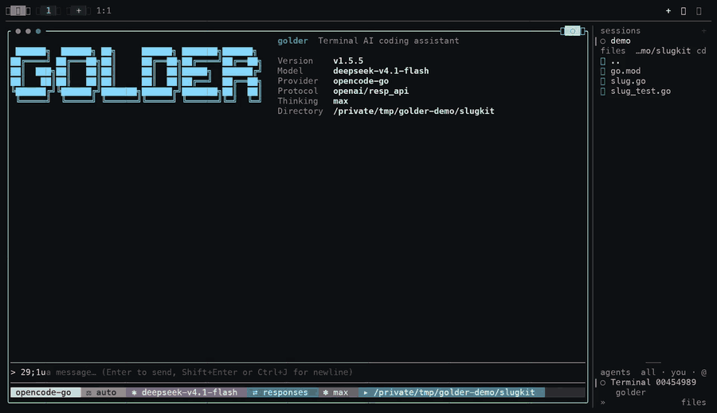
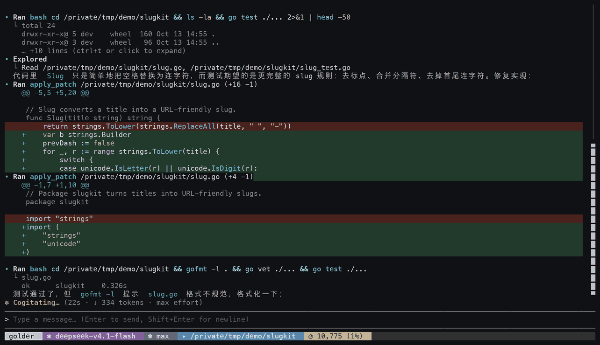
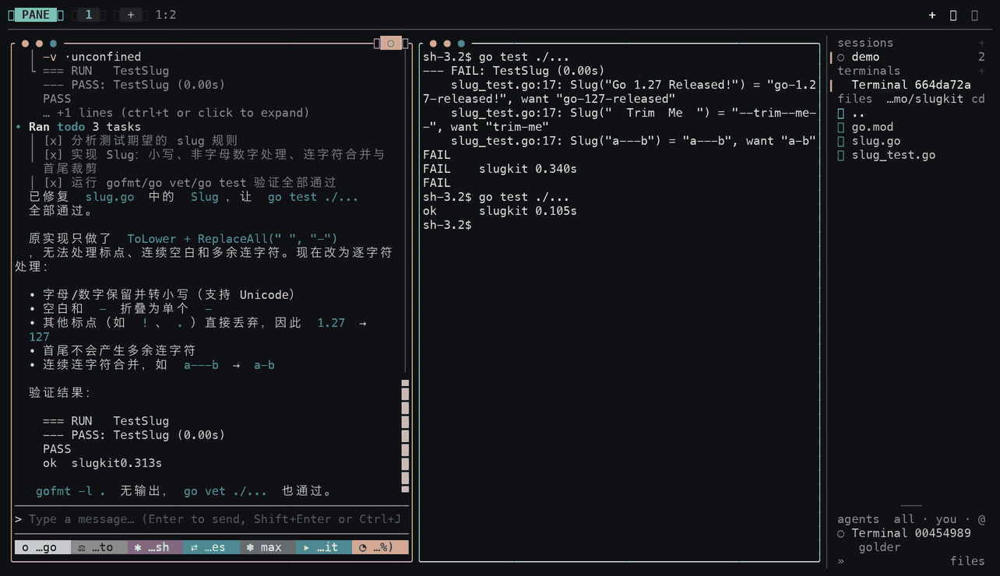

# golder

[English](README.en.md) | **简体中文** | [官网](https://golder-cli.pages.dev/)

[](https://github.com/getan/golder/actions/workflows/ci.yml)
[](https://github.com/getan/golder/actions/workflows/build.yml)
[](https://github.com/getan/golder/actions/workflows/release.yml)

用 Go 编写的终端 AI 编码助手：读写文件、执行命令、检索代码、抓取网页，在对话中完成从理解需求到改好代码的闭环。默认进入全屏 TUI，也支持行式 REPL 与无头脚本。

**单二进制、默认沙箱、密钥不进入模型上下文。**

## 安装

```bash
brew install getan/tap/golder
# 或
curl -fsSL https://golder-cli.pages.dev/install.sh | sh
```

macOS / Linux 一条命令装好，不需要 Node/Python。Windows 从 [Releases](https://github.com/getan/golder/releases) 下载 `.zip`；镜像、sha256 校验、从源码构建等细节见[安装细节](#安装细节)。

## 亮点

- **多 Provider 热切换，会话不绑定厂商**：`/provider` 随时换网关，`/resume` 在当前 provider 上继续同一份上下文；内置 19 个会话网关，覆盖 OpenAI Chat / Responses、Anthropic Messages、Gemini 四种线上协议，也可指向任意兼容端点。
- **轻量 agent + 真正的安全边界**：和 pi 同一量级的单二进制，但多了逐调用审批门与 OS 沙箱（`sandbox-exec` / `bubblewrap`）——读限工作区、写限项目与临时目录、网络默认关闭；密钥和凭据路径读不到。
- **比 codex-cli 更容易定制**：纯 Go，单语言、单二进制，没有 Node/Python 运行时；加一个工具、一个 provider 或一条审批规则，都在同一个 `go build` 里完成。
- **常驻内存约 50–100 MB**：同类里的第一梯队，长时间挂着跑也不占机器。
- **终端 / 浏览器 / 工作区在一个面板里**：`tuios` 管终端 pane，`browser` 通过 kitty-browse 的控制 socket 操作页面（snapshot/click/fill/wait/console/network），`workspace` 用预设（`debug-fullstack`、`data-analysis`、`review`）一次起好后端、前端和浏览器，再用 `snapshot` 把所有 pane 的上下文一次交给模型——前后端同时 debug 时最充分。`visual`（图表 / Mermaid / TML 面板）已下架，原因见 CHANGELOG 的 Removed 一节。
- **规划中：MCP 与插件生态**：把外部工具和数据源接进来，扩展不必改核心。

<p align="center">
  <a href="https://golder-cli.pages.dev/?utm_source=github&utm_medium=readme#demo">
    
  </a>
</p>

<p align="center">
  <sub>真实会话、无剪辑造假：<code>go test</code> 红 → 模型自主读码打补丁 → 全绿（14 秒 GIF，<a href="https://golder-cli.pages.dev/?utm_source=github&utm_medium=readme#demo">完整 26 秒录像</a>）</sub>
</p>

<table>
<tr>
<td width="50%"></td>
<td width="50%"></td>
</tr>
</table>

## 更多特性

- **TUI 优先**：直接 `golder` 进入全屏 TUI（转录、工具卡片、状态栏、↑↓ 选择菜单）；`--no-tui` 切回行式 REPL，两端命令与行为完全对齐；`golder -p "..."` 无头执行，适合脚本与 CI。
- **内置工具集**：文件读取、补丁编辑、ripgrep 代码检索、Shell 会话、任务清单、网页抓取、联网搜索等（见[内置工具](#内置工具)）。
- **tuios pane 工具**：在 tuios pane 内额外提供一个 `tuios` facade（`list` / `capture` / `wait` / `run` / `new` / `focus` / `close`），可管理当前 session 的所有 pane，等待走 daemon 事件而非轮询；见 [docs/tuios-tools.md](docs/tuios-tools.md)。
- **凭据脱敏**：tool output、用户 prompt、assistant 文本、compaction 摘要、memory 与 session 落盘前统一扫描；覆盖 AWS/GCP/Azure/GitHub/GitLab/Slack/Stripe/OpenAI/Anthropic/JWT/PEM/DB URL 等规则，支持 `off | observe | redact | block` 四档，审计只记规则名与 hash。
- **多 Provider**：默认 OpenCode 网关，内置 19 个网关（OpenAI / Anthropic / OpenRouter / DeepSeek 等），也可指向任意 OpenAI 兼容端点。
- **会话与分支**：`/resume` 切换历史会话（默认只看当前项目，`--all` 看全部），`/fork` 从任意历史消息分叉，`/clone` 复制当前会话，`/tree` 浏览分支树，`/export` `/import` 做会话存档往返，`/rewind` 把文件与对话一起回滚。
- **审批与沙箱**：四档权限模式（只读 / 每次询问 / 自动审批 / 完全放行）；**获准执行的 `bash` 调用一律在沙箱内跑**（macOS 用 `sandbox-exec`，Linux 用 `bubblewrap`，需已安装），与命令内容无关——原生文件工具（`read`/`grep`/`find`/`ls`/`view_image`/`apply_patch`）也由一次性沙箱 worker 执行。沙箱走**白名单**：可读仅限项目 + 系统运行时 + 两个 git 配置（`~/.gitconfig`、`~/.config/git/*`），`$HOME` 其余内容（shell rc、SSH/GPG 密钥、`~/.config/*`、凭据、历史）一律读不到；写默认限项目、临时目录与显式授权的写根；**网络默认关闭，且按次授权**——需要联网的调用声明 `network:"on"`，授权门在同一次审批里决定（批了仍在文件沙箱内，不必脱离沙箱）。**路径授权可在弹窗里一键记住**：读授权按 `a`（本会话）/`s`（记住）；写确认弹窗（`apply_patch` 写工作区外）按 `y`/`a`/`s`；越界申请与重准入弹窗里的写行是 `w`（本会话）/`s`（记住）。记住档直接写入 `~/.golder/grants.json`。同一份文件可用 `/boundary readable|writable list|add|rm` 查看与维护，无法编辑文件的机器（脚本、容器）用 `GOLDER_READABLE_ROOTS` 环境变量。工具链在 `$HOME` 内时用 `GOLDER_SANDBOX_READABLE` 追加读白名单。确实需要**文件**访问而沙箱挡不住时，模型可申请 `require_escalated`——这只是**同一次评审**里的又一个能力问题，不是第二轮审批：**`auto` 下档位就是全部答案**——`allow`/`confirm` 直接在沙箱外跑并播报，`contain` 收容，`deny` 不跑；`ask` 下弹窗把 `run outside the sandbox` 与其他能力一起列给你，`y`/`a`/`s` 即批准；`enforce` 永远收容，没人可问则收容或失败关闭。**命令被沙箱拒绝时**：只要输出或理由点得出路径，`auto` 由评审自动决定是否补授（不弹窗），`ask` 弹一次路径授权，批准后原命令在沙箱内自动重跑。
- **长任务支持**：`/compact` 上下文压缩、上下文预算工具、`/goal` 自主目标循环、`/btw` 侧线问答、子 Agent 派发、持久记忆与 `/dream` 记忆整理。
- **工作区外读取需确认**：读取类工具（`read` / `grep` / `find` / `ls` / `view_image`，以及 `bash` 命令里能识别出的文件操作数）默认只读工作区，越界会先问你——弹窗可选「只读这一次」「本会话允许读该目录」或「记住（跨会话，写入 `grants.json`）」；没有可问的人时失败关闭，并在消息里给出路径与配置办法；TUI/REPL 里的子 agent 会把问题送进同一个弹窗，标题标出 `(from task)` 之类的来源——人就坐在那儿看着，唯一真正问不到人的是 headless 与进程隔离的子 agent。这一步**不受权限模式影响**（完全放行关掉的是审查与沙箱，不是知情同意）。常用目录可预授权：`GOLDER_READABLE_ROOTS` 环境变量，或 `/boundary readable add <路径>`（写入 `grants.json`，重启后仍生效；同时放宽沙箱读白名单）；凭据路径（`~/.ssh`、`~/.zshrc` 等）永远不可授权。
- **按 Provider 的代理路由**：`/proxy` 单独选择哪些 provider 走代理，互不影响；未选中的 provider 直连，且不继承 shell 的 `HTTP_PROXY` / `HTTPS_PROXY`。
- **技能与模板**：`~/.agents/skills` 下的技能注册为 `/命令`（无内置技能，目录不存在时零命令）；提示词模板、项目级 `AGENTS.md` 自动装载。
- **在 tuios / herdr 里就是一个 agent**：跑在 [tuios](https://github.com/Gaurav-Gosain/tuios) 窗口或 [herdr](https://github.com/herdrdev/herdr) pane 里时，golder 自己上报状态，于是它出现在 rail/sidebar 上（working / 等待你 / 空闲 / 完成），审批与提问进 Inbox，daemon 重启后会带着 `golder --resume <会话>` 回到原会话。**两个宿主都不用改、也都不用装**：tuios 需要一份 harness manifest，`golder host-compat install` 写进 `~/.config/tuios/harnesses/`；herdr 什么也不需要，自报即识别。在 tuios 的 Inbox 里可以直接按键替你批准/拒绝——那条路依赖 manifest 里的屏幕规则，所以**改了审批弹窗的文案要同步改那份 manifest**（见 `internal/hostcompat/README.md`）。`golder host-compat status` 说明当前宿主与缺什么；`GOLDER_HOST_REPORT=off` 一键关闭上报。

## 安装细节

### Homebrew（macOS / Linux）

```bash
brew install getan/tap/golder
```

### 一键安装（Linux / macOS）

```bash
# 一、站点镜像（对多数大陆网络更稳）
curl -fsSL https://golder-cli.pages.dev/install.sh | sh

# 二、GitHub 原始地址（pages.dev 不通时改用，如阿里云 ECS 等大陆云主机）
curl -fsSL https://raw.githubusercontent.com/getan/golder/master/install.sh | sh
```

两条取到的是同一份脚本（站点部署时从主仓库镜像），按自己的网络二选一；若两条都不通，可给 raw 地址套镜像前缀，例如 `curl -fsSL https://ghfast.top/https://raw.githubusercontent.com/getan/golder/master/install.sh | sh`。

脚本会校验下载包的 sha256；下载归档时先直连 GitHub，失败后自动回退到公益镜像（`ghfast.top`、`ghproxy.net`、`gh-proxy.com`、`gh.zwy.one`）。连上后 15 秒无数据、或平均速度低于 50KB/s 持续 15 秒（龟速滴流），都会判死并切换下一个源。校验文件（`checksums.txt`）走信任阶梯：优先直连 GitHub；直连不可用时改用镜像副本，但要求各应答来源对同一归档给出一致的 sha256，不一致立即中止（单个镜像无法同时伪造归档和校验文件）；受限网络下只有一个镜像可用时继续安装但会明确告警。`GOLDER_MIRROR` 可覆盖镜像列表（空格分隔的 URL 前缀，前缀拼在原 URL 前），设为 `off` 只用直连。

可用 `GOLDER_VERSION` 指定版本、`GOLDER_INSTALL_DIR` 指定安装目录（默认 `/usr/local/bin`，无写权限时回退 `~/.local/bin`）。Windows 请从 [Releases](https://github.com/getan/golder/releases) 下载 `.zip` 解压。

### 从源码构建

需要 Go 1.27 或更高版本：

```bash
git clone https://github.com/getan/golder.git
cd golder
go build ./cmd/golder      # 生成 ./golder
go install ./cmd/golder    # 安装到 $GOPATH/bin
```

## 配置

### API Key 一览（重要）

| 用途 | 环境变量 | 说明 |
|------|----------|------|
| 默认网关 OpenCode | `OPENCODE_API_KEY` | `opencode-go` 订阅网关，默认 provider |
| Zen 网关 | `OPENCODE_ZEN_API_KEY` | `opencode-zen`，与 Go 分开计费、独立 Key |
| 联网搜索（首选） | `TAVILY_API_KEY` | Tavily，面向 LLM 优化的结果 |
| 联网搜索（次选） | `EXA_API_KEY` | Exa，返回 highlights 摘要 |
| 其他网关 | `<PROVIDER>_API_KEY` | 如 `DEEPSEEK_API_KEY`、`XAI_API_KEY`；见 `golder --help` 全表 |

联网搜索后端按 **Tavily > Exa > DuckDuckGo** 自动选择：两者都没配时，用无需 Key 的 DuckDuckGo 兜底（大陆网络访问 DuckDuckGo 需要代理）。

### OpenCode（默认）

golder 默认走 `opencode-go` 网关，模型 `deepseek-v4.1-flash`，推理档位 `max`。只需设置 API Key：

```bash
export OPENCODE_API_KEY=...
golder
```

若本机网络无法直接访问 `opencode.ai`，配置代理即可；**代理出口不要求美国**，普通线路能连通就行：

```bash
export GOLDER_PROXY=http://127.0.0.1:7897
```

#### Muse / Grok 的区域与开关要求（重要）

- **只有 `muse-spark-*` 和 `grok-*` 需要美国出口 IP**；其他国产模型（DeepSeek、Qwen、MiniMax、GLM、Kimi 等）直连即可，不需要代理。
- **Muse Contributor 模型必须开通"允许使用数据改进模型"的开关**，否则调用会报 `This model collects data used to improve its quality and requires explicit opt in`。开关在 OpenCode 工作台的 Go 页面：

  ```text
  https://opencode.ai/auth                                   # 登录
  https://opencode.ai/workspace/<你的 workspace-id>/go       # 打开数据分享开关
  https://opencode.ai/docs/go/                               # Go 订阅模型与定价
  https://dev.meta.ai/docs/pricing-rate-limits#contributor-tier   # Meta Contributor 条款
  ```

- golder 检测到 muse 模型会自动使用 Responses 协议，无需手动设置。

用美国出口代理调用 Muse 的示例：

```bash
export GOLDER_PROXY=http://127.0.0.1:7897    # 代理节点需为美国出口
golder -m muse-spark-1.3-contributor
```

### 代理路由（/proxy）

`/proxy` 打开代理选择器：方向键选择 provider，Enter 开关并自动保存，Esc 退出。也可以直接输入：

```text
/proxy url http://127.0.0.1:7897
/proxy openai on
/proxy anthropic on
/proxy deepseek off
```

代理地址与 provider 选择相互独立。`GOLDER_PROXY` 优先于保存的地址，但不会让所有 provider 走代理；未选中的 provider 直接连接，不继承 `HTTP_PROXY` / `HTTPS_PROXY`。显式启用代理却未设置地址时，会提示配置地址。尚未保存选择时保留 OpenCode 的历史默认行为：设置地址才走代理。

选择保存在 `~/.golder/proxy.toml`，立即用于后续聊天和模型列表请求，重启后继续有效。例如：

```toml
url = "http://127.0.0.1:7897"
providers = ["openai", "anthropic"]
```

### OpenAI 中转站

通过 `OPENAI_BASE_URL` 设置地址，是否走代理由 `/proxy` 单独控制：

```bash
export OPENAI_BASE_URL=https://relay.example.com/v1
golder --provider openai
```

聊天使用该地址，模型列表请求同一个地址下的 `/models`，缓存也按实际地址区分。`/provider` 列表及 `--help` 显示各 provider 的 API Key 和 `*_BASE_URL` 变量名；选择器的详情区显示实际地址、配置来源和代理状态。`BASE_URL` 是可选项，不设置时使用官方默认地址。

### 配置文件

全局配置放在 `~/.golder/config.toml`，键名与 CLI flag 对应（命令行传入时优先）：

```toml
provider = "opencode-go"
model = "deepseek-v4.1-flash"
thinking_level = "max"            # off | minimal | low | medium | high | xhigh | max
# base_url = "https://..."        # 覆盖 Provider 默认端点
# api_key = "..."                 # 建议改用环境变量或 credential 引用
# credential = "my-key"           # 引用 ~/.golder/.credentials.yaml 中的条目
```

也可以用环境变量覆盖：`GOLDER_MODEL`、`GOLDER_PROVIDER`、`GOLDER_THINKING_LEVEL`、`GOLDER_PERMISSIONS`。命令行 flag 优先级最高。项目级还可以放一份 `.golder/config.json` 覆盖 `model` / `provider` / `thinkingLevel` / `hooks`——仅在目录被信任时加载。

### tuios shell integration（zsh / bash，推荐）

推荐在 tuios pane 里运行 golder。要完整使用 tuios 的窗口与命令管理，尤其是 `tuios run`、`wait-for command-finished`、`capture-pane --last-command`，pane 的 shell 必须发送 OSC 133 命令标记；否则这些操作会报 `no_shell_integration`，golder 内置 `tuios` 的 `run` 也只能走降级路径。只使用 `list`、`capture`、`wait`（如 `window-output` / `window-idle`）时不需要这些标记。

把对应配置追加到 shell rc 文件末尾，并放在 Starship、Powerlevel10k、oh-my-zsh 等 prompt 初始化之后。

#### zsh

```zsh
# ~/.zshrc: mark commands for tuios run (OSC 133)
autoload -Uz add-zsh-hook
_tuios_osc133_precmd()  { local s=$?; print -n "\e]133;D;$s\a\e]133;A\a"; }
_tuios_osc133_preexec() { print -n "\e]133;C\a"; }
add-zsh-hook precmd _tuios_osc133_precmd
add-zsh-hook preexec _tuios_osc133_preexec
PS1+=$'%{\e]133;B\a%}'
```

#### bash

```bash
# ~/.bashrc: mark commands for tuios run (OSC 133)
# Needs bash 4.4 or newer. Older bash, such as macOS /bin/bash 3.2, ignores
# PS0, so it marks prompts and never commands, and run refuses the pane.
PROMPT_COMMAND='printf "\e]133;D;%s\a\e]133;A\a" "$?"'${PROMPT_COMMAND:+";$PROMPT_COMMAND"}
PS0='\e]133;C\a'
PS1+='\[\e]133;B\a\]'
```

macOS 自带的 `/bin/bash` 是 3.2，不支持这套 `PS0` 配置；请安装 bash 4.4+（例如 `brew install bash`）并把登录 shell 切到它，或直接用 zsh。

新增的 tuios pane 会自动生效；已经打开的 pane 需要重载：

```bash
source ~/.zshrc      # zsh；也可以 exec zsh
source ~/.bashrc     # bash
```

然后验证：

```bash
tuios doctor shell
```

对应当前 pane 的 `marks_commands` 应该是 `true`。旧 pane 在重载前通常是 `false`。

这里的 shell integration 和 `golder host-compat install` 是两件事：前者让 tuios 能识别命令边界，后者把 golder 的状态、审批和提问写进 tuios 的 harness manifest，供 rail 与 Inbox 使用。推荐两者都配置。

### 其他 Provider

可切换的内置网关都能用 `--provider <name> -m <model>` 选中，API Key 按 `<PROVIDER>_API_KEY` 约定从环境变量读取（如 `DEEPSEEK_API_KEY`、`ZAI_API_KEY`），完整列表见 `golder --help`（其中标注了唯一的例外：`typesafe` 是审查器用的决策模型，不接会话，只能用 `/proxy` 路由）。自定义端点直接指定协议与地址：

```bash
golder --provider deepseek -m deepseek-v4-flash -p "解释这段代码"
golder -P openai -u https://my-gateway.example.com/v1 -m my-model -k "$MY_KEY" -p "..."
golder -m ollama/qwen2.5-coder -u http://localhost:11434/v1 -p "..."   # 本地 Ollama
```

### 模型与推理档位

交互式里 `/model` 列出当前网关的模型并标注每个模型支持的推理档位；TUI 中选中模型后会接着让你选档位（Esc 取消整次切换），也可用 `/model <序号|id> <档位>` 一步切换。只调当前档位用 `/model think <档位>`（不带参数则显示当前档位），因为档位属于模型，入口统一在 `/model` 下。

`/provider` 列出全部内置网关：每个网关需要哪些环境变量、当前有没有配好（已配好的排在最前），`/provider <名称>` 直接切换网关（自动用该网关的默认模型）。审查器的决策模型（`typesafe`）单独列在最后一节，并拒绝切换：它回答的是审查器的类型化提问，不是聊天模型，给它路由请用 `/proxy`。TUI 里 `/provider` 是方向键选择器，同样不包括决策模型。

**默认 provider（新会话从哪个网关开始）**：`/provider default <名称>` 把它写进 `~/.golder/config.toml` 的 `provider` 行（`/provider default` 查看、`/provider default off` 清除）；如果配置文件里已经钉了 `model`，那一行会一起换成新网关自己的默认模型，避免把某个网关的模型 id 发给另一个网关。列表里带 `(default)` 的就是它，`(current)` 是当前会话用的那个——两者可以不同。TUI 选择器里按 `d` 直接把高亮的一行设为默认，不用退出列表。改文件只动这两行，注释和其余设置原样保留。

档位元数据来自 models.dev（网关自身的 `/models` 只返回模型 id，不含档位）。模型列表与档位表都以 24 小时磁盘缓存存在 `~/.golder` 下，因此每个网关大约一天只请求一次，而不是每次会话都请求。

## 内置工具

工具根植于当前工作目录；`--no-tools` 整体禁用，`--allowed-tools` / `--disallowed-tools` 做工具级准入（黑名单优先，子 Agent 继承，`--approve` 不可绕过）。

| 工具 | 说明 |
|------|------|
| `read` | 按路径读取文本文件，支持 offset/limit，输出带行号 |
| `view_image` | 读取本地图片（PNG/JPEG/GIF/WebP，≤8MiB）作为图片块附加给模型 |
| `apply_patch` | 一次补丁调用增删改移多个文件，返回逐文件 diff |
| `grep` / `find` | ripgrep 引擎的内容检索 / 文件名查找；`path` 支持单个目录或目录列表，`exclude` 排除、`glob`/`type` 圈定，`limit` 限条数（默认 1000）；自动跳过 `.gitignore` 与二进制文件 |
| `bash` | 执行 shell 命令，流式输出；未在等待窗口内结束则转为会话并返回 `bash_id`；`tty=true` 支持交互式程序 |
| `write_stdin` | 轮询 bash 会话输出、写入输入或发送中断（`\u0003`） |
| `todo` | 结构化任务清单（pending / in_progress / completed） |
| `webfetch` / `websearch` | 抓取网页转 Markdown / 联网搜索（按凭证自动选择后端：Tavily / Exa / DuckDuckGo） |
| `task` | 派发子 Agent（继承父级工具边界） |
| `memory_search` | 检索持久化记忆（BM25 全文索引） |
| `get_context_remaining` / `new_context` | 查看剩余上下文预算 / 主动开启新上下文窗口 |
| `schedule_create` / `schedule_list` / `schedule_delete` | 会话内定时提醒：到点后作为新消息回到对话（不持久化） |

**持久记忆的每轮自动召回（默认关）**：除 `memory_search` 工具外，还有一条自动通道——把最近一条用户消息当查询做 BM25，命中就以 `<system-reminder>` 注入当轮请求（只进请求，不进历史、不上转写）。它默认**关闭**，因为注入是每轮都付的上下文成本：`/memory recall on|off` 开关（写 `config.toml` 的 `[memory] recall`，当前会话立即生效）。打开后有守卫：查询至少 2 个单元（英文词 / 中文二字组——"继续""ok"不算），命中至少共享 2 个单元；索引对账默认最多每 30 秒一次（`recall_reconcile_seconds`，`0` 为每轮、负数关闭），因为那一步是线性遍历记忆文件。`/memory` 报告会显示策略和最近一次决定（是否注入、查询原文、命中的文件），"为什么突然想起这个"因此有据可查。

`/goal` 运行期间还会额外挂载 `goal_complete` / `goal_blocked` 两个目标控制工具，仅在自主循环内可见。

## 斜杠命令

TUI 输入 `/` 会按下面的分类弹出菜单（↑↓ 选择）；`/help` 输出同一份分组列表。两类界面（TUI 与 REPL）命令完全对齐。

| 分类 | 命令 |
|------|------|
| General | `/help` `/status` `/exit` |
| Session | `/resume` `/compact` `/fork` `/clone` `/tree` `/rewind` `/export` `/import` |
| Model | `/model` `/provider` `/proxy` |
| Memory | `/memory` `/dream` |
| Permissions | `/permissions` `/trust` `/boundary` `/grants` |
| Modes | `/goal` `/btw` `/remote-control` |
| Extensions | 技能、插件、提示词模板按来源列在这里 |

要点：

- `/compact` 立即对上下文做一次摘要压缩；`/status` 内含会话 id、消息数、创建时间与上下文用量（原 `/session` 已并入）。
- **Ctrl+C 的一致行为**：运行中按一次即请求中断（会打印 `(interrupting…)`，随后以同一句 `Interrupted.` 结算）；同一次运行内再按不会重复提示，也不会提前退出。空闲时按一次清掉草稿（并提示已丢弃），输入框为空时第一次按下只"待命"（提示再按一次），第二次才退出——与 codex 一样，不设"运行中双击强退"，避免误触丢掉未落盘的一轮。Esc 与 Ctrl+C 的中断行为一致。
- **Ctrl+Z 挂起**：任何状态下按 Ctrl+Z 都把终端交还给它自己的作业控制（bubbletea 释放终端并发出 SIGTSTP），`fg` 回来时重新按当前尺寸排版——与 codex 及别的终端 UI 一致。
- **`!command` 直通**：输入框里以 `!` 开头的一行在本地直接执行——不调用模型、不走审批、不进沙箱——并以 codex 的 user 角色 `<user_shell_command>` 记录进入对话（命令、退出码、耗时，以及掐头去尾的输出），所以模型看到的正是你跑了什么、回来了什么。TUI 会先亮出一张流式 `• Running …` 卡片，结算成 `• You ran …`；运行途中落下的记录会先寄存、等这轮跑完再并入，不与持有上下文的主循环抢写。TUI 与 REPL 都有，↑ 召回的是你敲的那行原文，只有 `!` 时打印用法提示。
- 四个命令各答一件事：`/trust` 只说本目录能不能跑副作用工具，`/boundary` 只说工作区外哪些路径可读/可写，`/permissions` 只管审批档位，`/grants` 是整张表本身。`/grants list` 列出**全部**条目：按路径排序的每一条已保存的信任决定（当前目录标出）、本会话才有的授权、以及记下的拒绝，末尾写明它读的是哪个文件；`/boundary list` 打印两类路径授权（可读/可写）的来源与所在文件、以及怎么改。`/trust status` 仍然只回答"这个目录适用什么"。
- **resume 会用当前二进制重建系统提示**：续跑旧会话时，工具用法指南、环境块（工作目录、日期、rg 是否可用）、AGENTS.md 与技能清单都按**现在**重新生成，不再沿用会话文件里冻结的那份（旧会话里那份的日期停在创建当天，AGENTS.md 的改动也不生效）；而你自己写的部分——`--system-prompt` 的替换文本与 `--append-system-prompt` 的追加块——会原样保留，本次启动显式传入的 flag 优先。会话文件里仍记录创建时的原样 prompt，`/export --include-system-prompt` 看到的是它。
- `/resume`、`/fork`、`/tree`、`/rewind` 在 TUI 中都是方向键选择器，REPL 中输入序号选择。`/resume` 默认只列**当前项目**的会话（项目 = 启动目录所在仓库的根，子目录与根共享一份历史），列表里每条都带运行目录；`/resume --all` 列出所有项目，被过滤掉或超出范围时列表会给出提示并指到 `--all`。`--resume <id>` 与 `/resume <id>` 始终全局精确命中，不受项目过滤影响。
- 技能目录 `~/.agents/skills` 里每多一个技能就多一条 `/命令`；全新用户没有该目录时，Extensions 组为空。可用 `GOLDER_SKILLS_DIR` 换目录、`--no-skills` 全关。

## 使用

```bash
# 交互式 TUI（不带 -p 且 stdout 为终端时自动进入）
golder

# 无头模式：只输出最终回答文本
golder -p "读取 README 并总结这个仓库"

# 逐行 JSON 事件（首个事件带 session_id），便于脚本消费
golder -p "列出所有 Go 文件" --output-format stream-json

# 续跑本项目最近的会话（本项目没有会话时退回全局最近一条，并在 stderr 说明来源目录）
golder --continue
golder --resume <session-id>
golder -l                     # 列出全部项目的会话（含运行目录）

# 会话导出 / 更新二进制
golder session export <session-id> --format md --output talk.md
golder update

# 在 tuios / herdr 里被认出来（见上「特性」）
golder host-compat status      # 当前宿主、以及缺什么
golder host-compat install     # 写 tuios 的 harness manifest（herdr 不需要）
golder host-compat uninstall   # 只删 golder 自己写的那份
```

`golder update` 的版本检查走站点接口（大陆可达、无速率限制），失败回退 GitHub API；下载 release 时与安装脚本同一条「直连 → 公益镜像」回退链，归档按 release 的 `checksums.txt` 校验（坏包自动换下一个源），而 `checksums.txt` 本身优先直连 GitHub，只有镜像应答时要求各来源一致（单源可用时告警后继续）；`GOLDER_MIRROR=off` 可禁用镜像。

### 批准之后的信封（envelope）

四档模式回答"准不准跑"，信封回答"在哪跑"；两者正交，并且**修订**了上面"获准执行的 bash 调用一律在沙箱内跑"的说法：

- 整条命令可完整枚举且不碰凭据的批准调用（`git push`、`go test`、`ls`、`cargo build` 等）直接在宿主上跑，卡片/REPL 标 `·unconfined`，结果 `details.envelope` 为 `bare`；
- 含变量/替换/进程替换、解释器或包装器（`bash`/`python`/`make`/`docker`/`env` 等）、凭据路径的仍收容（`sandbox`）；
- 原生文件工具（`read`/`grep`/`find`/`ls`/`view_image`/`apply_patch`）由 `toolworker` 的一次性沙箱执行时也标 `·sandbox`；`full-access`/Direct/无 runner 退回进程内时标 `·unconfined`；`todo`/`websearch`/`webfetch` 等不走 OS 沙箱的工具没有标记；
- `GOLDER_SANDBOX=enforce` 仍把每一条都收进沙箱，优先于信封；`full-access` 不变。

网络是另一个维度，并且**按次**决定：没有持久化的网络白名单，也没有单独的 `/network` 命令。需要联网的调用由模型在 `bash` 参数里声明 `network:"on`；这条能力请求和外部路径、沙箱外运行一起进入同一次能力决策。`auto` 下评审的 Allow/Confirm 直接携带声明的网络，Contain 只在评审同时授予网络时保留；`ask` 在同一个弹窗里问；`read-only` 拒绝；`full-access` 不问。信封只决定执行位置，不改变网络授权。

### 权限模式

改动型工具（`bash` / `apply_patch`）的审批由四档模式控制，启动时默认 `auto`，运行中用 `/permissions` 切换，也可用 `--permissions <mode>` 或 `GOLDER_PERMISSIONS` 指定：

| 模式 | 行为 |
|------|------|
| `read-only` | 只允许工作区内读取；写入、联网、沙箱外运行直接拒绝 |
| `ask` | 评审先过滤安全调用；其余调用把所有所需能力（外部路径、网络、沙箱外）合并成一次弹窗问你 |
| `auto`（默认） | 评审（JEV/local 优先，必要时 LLM）同时决定风险与能力扩张；`allow`/`confirm` 自动授予全部所需能力，包括沙箱拒绝后的路径补授，不打断 |
| `full-access` | 不审查、不询问、不套沙箱；仅保留静态硬拒名单（`sudo`、`rm -rf /` 等） |

边界、网络和沙箱不再各自弹窗：它们是同一次能力请求的不同维度。完整矩阵与实现见 [docs/permissions.md](docs/permissions.md)。旧版“边界任何档位都问、网络另问一次”的描述已被本表取代。

首次在某个目录启动时会询问是否信任该目录；`--approve` 可为单次运行直接授权。未信任目录里也可以只放行读取（`read` / `grep` / `find` / `ls` / `view_image`，本会话 × 本目录）：TUI 弹窗选 `Allow reads in this folder (this session)`，REPL 按 `a`；命令与联网读取仍逐次询问，`/trust off` 会连读授权一起撤销。**首启信任弹窗的按键**：`s` 记住、`p` 本会话、`n` 记住不信任、Esc 取消（不落盘）；**运行中的信任问句**另一套键：`y` 仅这一次、`a` 本会话允许本目录的读取、`p` 本会话允许全部工具——运行中这一问不落盘，持久化是启动选择器的职责。需要操作系统级隔离时参见 [docs/sandboxing.md](docs/sandboxing.md)。

**网络授权（统一能力模型）**：网络是能力请求的一维，不再单独弹第二次窗，也不再有“记住的 host/command 规则”。`auto` 的 `allow`/`confirm` 直接授予本次调用声明的网络；`ask` 把它和外部路径、沙箱外运行合并进同一个弹窗；`read-only` 拒绝，`full-access` 不问。一次批准只覆盖这一次调用；旧的 `network_grants.json` 与 `network.toml` 不再读取，可以删除。

### 常用开关

| 参数 | 说明 |
|------|------|
| `-p, --print` | 无头模式的 prompt（位置参数等价） |
| `-m, --model` / `--provider` | 选择模型与网关 |
| `-a, --approve` | 本次运行信任工作目录，跳过逐次确认 |
| `--thinking-level` | 推理档位：`off` / `minimal` / `low` / `medium` / `high` / `xhigh` / `max` |
| `--no-tools`、`--allowed-tools`、`--disallowed-tools` | 工具级准入控制 |
| `--no-skills`、`--no-prompt-templates` | 关闭技能 / 提示词模板发现 |
| `--no-tui` | 交互模式下改用行式 REPL（不使用全屏 TUI） |
| `--debug` / `GOLDER_DEBUG=1` | 打开诊断渲染（当前包括默认隐藏的 allow 审批行） |

完整参数见 `golder --help`。

## 目录与环境变量

| 路径 / 变量 | 用途 |
|-------------|------|
| `~/.golder/config.toml` | 全局配置（`provider`/`model` 可用 `/provider default <名称>` 写入） |
| `~/.golder/proxy.toml` | `/proxy` 保存的代理地址和 provider 选择 |
| `~/.golder/grants.json` | 唯一授权表（信任决定与路径读写授权） |
| `~/.golder/sessions` | 会话存储（JSONL） |
| `~/.golder/.credentials.yaml` | 命名的 API Key 凭据（建议 0600 权限） |
| `~/.agents/skills` | 技能目录（注册为 `/命令`；不存在则无扩展命令） |
| `GOLDER_HOME` | 覆盖 `~/.golder` 基础目录 |
| `GOLDER_SKILLS_DIR` | 覆盖技能发现目录（默认 `~/.agents/skills`） |
| `GOLDER_PROXY` | 为选中的 provider 提供代理地址，优先于 `/proxy` 保存的地址 |
| `GOLDER_SANDBOX` | 执行隔离：`off`（不启用）/ `auto`（默认，获准的 bash 默认收容；可完整枚举的信封直接跑）/ `enforce`（全部收容，且强制要求 runner） |
| `GOLDER_STREAM_RESUME` | `0`/`false`/`off`：关闭文本续写；默认开：流在已输出文本且无工具调用时被切断，自动从断点续写；`commandcode` 另用禁用压缩和连接复用的传输（HTTP/2 保留） |
| `GOLDER_STREAM_FIRST_CONTENT_TIMEOUT` | 首个内容帧的等待预算（Go duration，默认 `2m`）；超时即重试，不再随尝试次数放宽 |
| `GOLDER_STREAM_IDLE_TIMEOUT` | 连续无任何字节的空闲窗口（Go duration，默认 `90s`）；SSE keep-alive 不计入内容进度 |
| `GOLDER_SANDBOX_READABLE` | 追加沙箱读白名单（冒号/逗号分隔的绝对路径），如 `/Volumes/KIOXIA:$HOME/miniconda3` |
| `GOLDER_READABLE_ROOTS` | 追加读取类工具（read/grep/find/ls/view_image）的免询问目录（冒号/逗号分隔），等同 `/boundary readable add`；同时放宽沙箱读白名单 |
| `GOLDER_MIRROR` | 自更新 / 安装脚本的下载镜像：空格分隔的 URL 前缀，或 `off` 禁用（默认直连 GitHub 失败后回退公益镜像） |
| `GOLDER_HOST_REPORT` | 宿主上报开关：`off` 关闭；`tuios` / `herdr` 强制指定（默认按 pane 环境自动判断，不在宿主里则不上报） |
| `GOLDER_DEBUG` | `1`/`true`/`on`：打开诊断 UI；当前用于显示默认隐藏的 allow 审批行 |
| `OPENAI_BASE_URL` 等 `<PROVIDER>_BASE_URL` | 覆盖该 provider 的聊天和模型列表 API 地址 |
| `TAVILY_API_KEY` / `EXA_API_KEY` | 联网搜索后端凭证（Tavily / Exa） |
| `~/.golder/model-catalog.json`、`reasoning-catalog.json` | 模型列表 / 推理档位的 24h 缓存 |
| `OPENCODE_API_KEY`、`OPENCODE_ZEN_API_KEY` 等 `<PROVIDER>_API_KEY` | 各 Provider 的 API Key（`opencode-go` 用 `OPENCODE_API_KEY`，`opencode-zen` 只用 `OPENCODE_ZEN_API_KEY`） |

## Star History

[](https://star-history.com/#getan/golder&Date)

## 许可证

[MIT](LICENSE)
